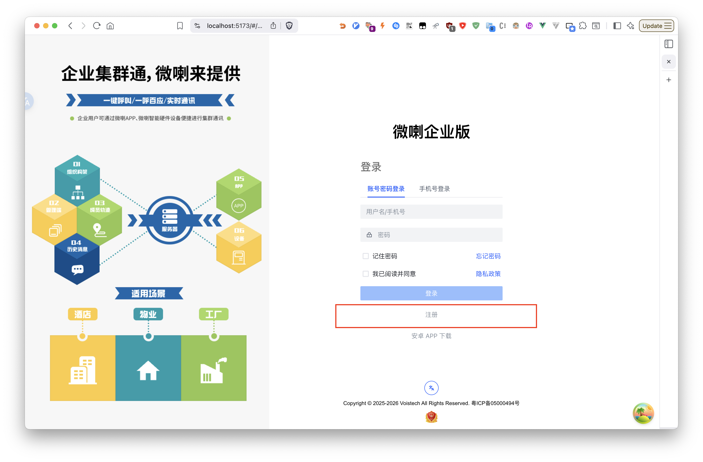
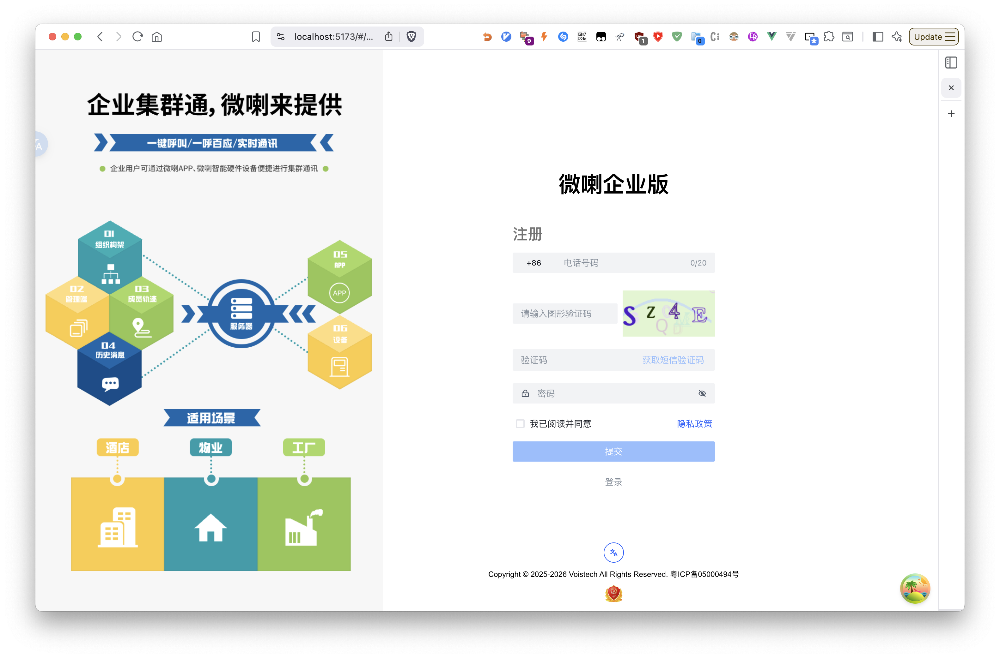
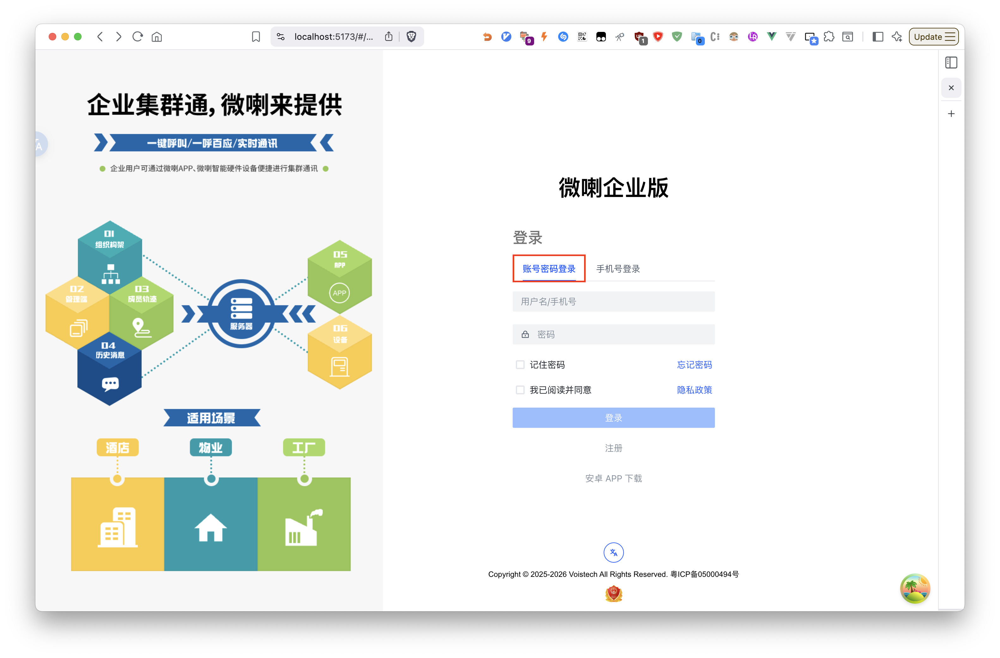
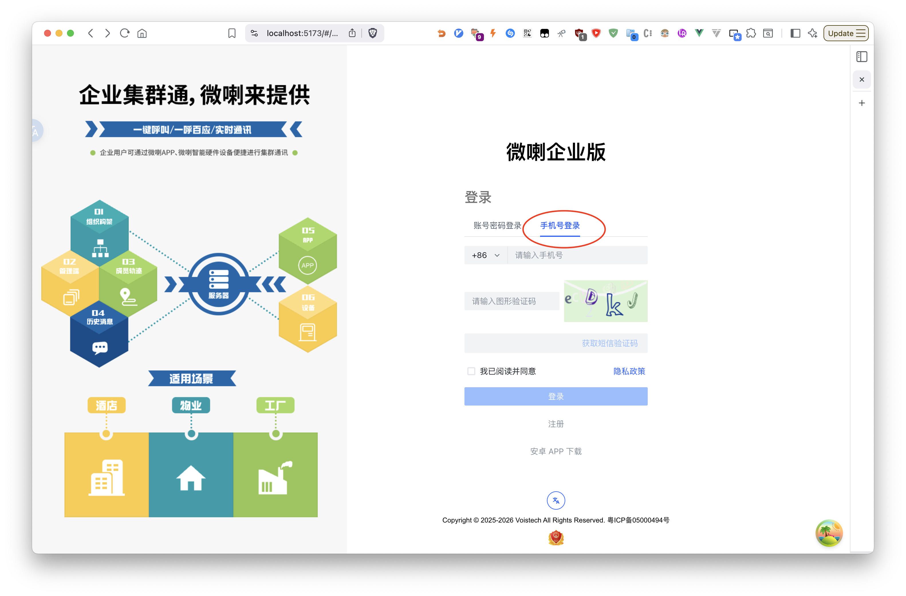

# 账户管理

## 1.1. 注册账号

**步骤说明：**

1. **访问注册页面**
   - 在登录页面点击"注册"按钮进入注册页面

2. **填写注册信息**
   - 输入手机号码（11位）
   - 输入图形验证码
   - 获取并输入短信验证码
   - 设置登录密码
   - 阅读并同意隐私协议

3. **完成注册**
   - 点击"注册"按钮提交信息
   - 注册成功后自动跳转到登录页面

**注意事项：**

- 手机号必须是有效的11位数字
- 密码需要符合安全要求
- 必须同意隐私协议才能注册

## 1.2. 账号/手机号登录

**登录方式：**

### 方式一：密码登录

1. 输入账号/手机号
2. 输入密码
3. 可选择"记住密码"功能
4. 点击"登录"按钮

### 方式二：短信验证码登录

1. 切换到"手机号登录"标签页
2. 选择国家代码（默认+86）
3. 输入手机号码
4. 输入图形验证码
5. 获取短信验证码
6. 输入收到的短信验证码
7. 点击"登录"按钮

**功能特点**

- 支持账号密码和手机验证码两种登录方式
- 记住密码功能方便下次快速登录
- 忘记密码时可点击"忘记密码"链接重置
