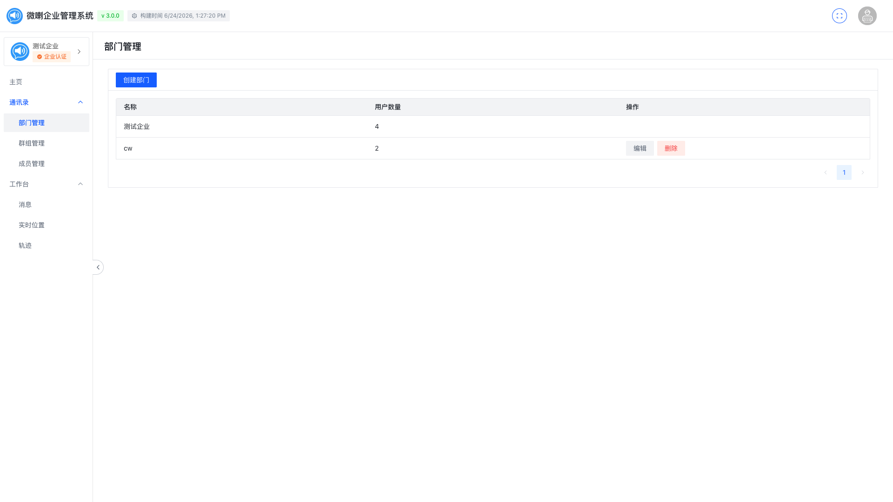
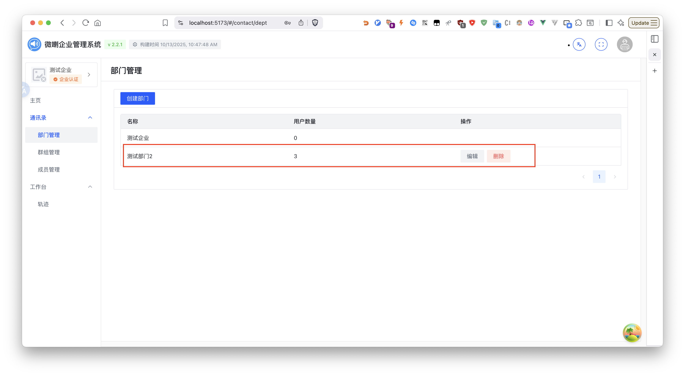
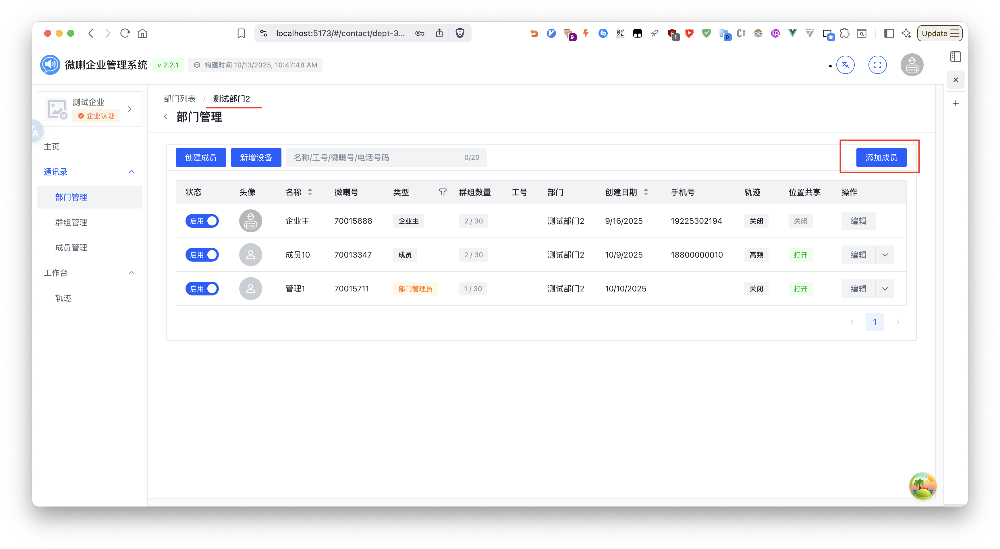
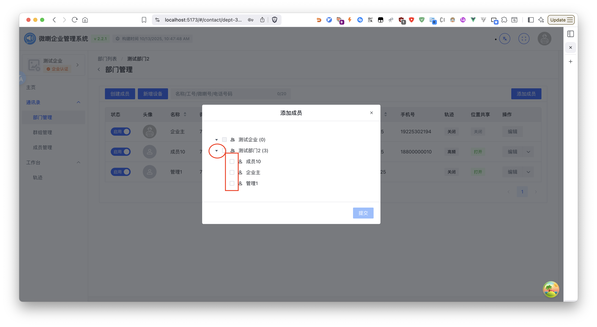

# 部门管理

部门管理用于维护企业的组织架构，支持创建、编辑和删除部门。

## 创建部门

1. 点击"创建部门"按钮
2. 填写部门名称等必要信息
3. 提交后部门会出现在列表中

## 编辑与删除部门

- 在部门列表的"操作"列中，可对已有部门进行编辑或删除
- 删除部门前请确认该部门下已无成员，或已将成员迁移至其他部门

## 在部门内添加已有成员

**操作步骤：**
1. 进入部门详情页面
2. 点击"添加成员"按钮
3. 在部门树中选择要添加的成员
4. 勾选需要添加的成员
5. 点击"提交"完成添加

**功能特点：**
- 支持批量添加成员到部门
- 可视化部门树结构
- 可查看部门内现有成员列表

