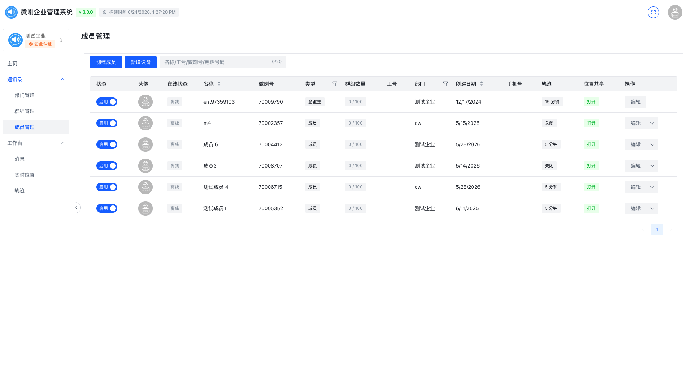
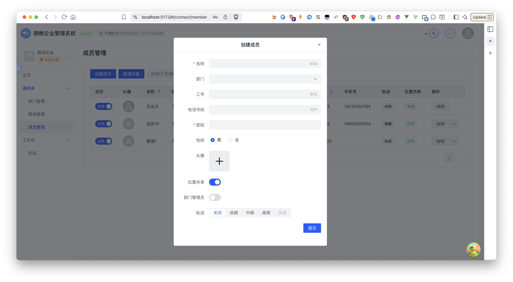
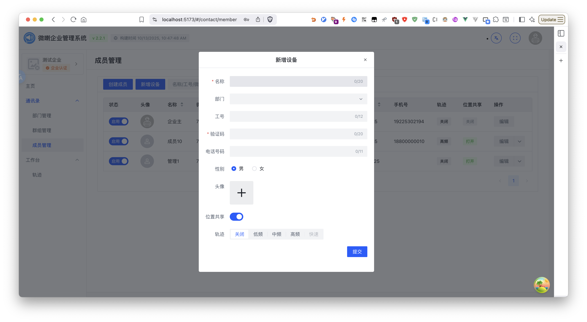
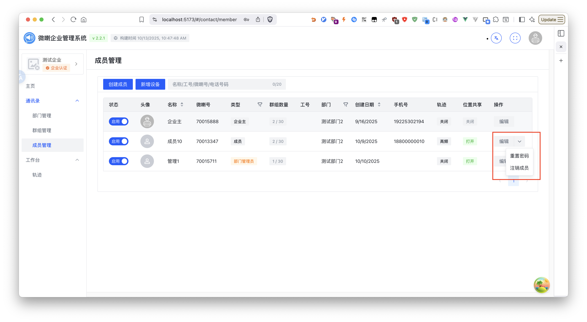

# 成员管理

成员管理页面展示企业下所有成员的信息，包括状态、头像、在线状态、名称、微喇号、类型、群组数量、工号、部门、创建日期、手机号、轨迹与位置共享等。

## 创建新成员

**操作步骤：**
1. 在成员管理页面点击"创建成员"按钮
2. 填写成员信息：
   - **姓名**（必填）：成员真实姓名
   - **部门**（可选）：选择所属部门
   - **工号**（可选）：员工工号
   - **手机号**（可选）：联系方式
   - **密码**（必填）：初始登录密码
   - **性别**（可选）：选择性别
   - **头像**（可选）：上传成员头像
   - **位置共享**（可选）：是否开启位置共享
   - **部门管理员**（可选）：是否设置为部门管理员
   - **轨迹权限**（可选）：设置轨迹查看权限级别

3. 点击"提交"完成创建

## 新增设备

**操作步骤：**
1. 点击"新增设备"按钮
2. 填写设备信息
3. 完成设备添加

## 成员操作

对成员可以进行以下操作：

### 编辑成员信息
- 修改成员基本信息
- 更新部门、职位等信息
- 重新设置头像

### 重置密码
- 为成员重置登录密码
- 系统会生成新密码

### 注销成员
- 将成员从系统中移除
- 操作前会有二次确认提示

