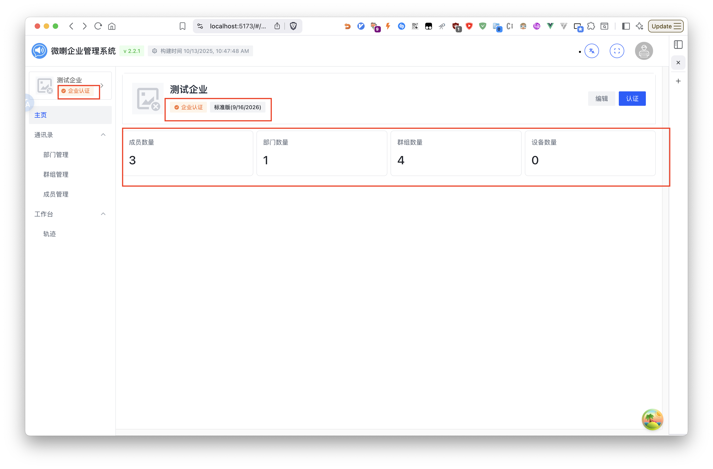
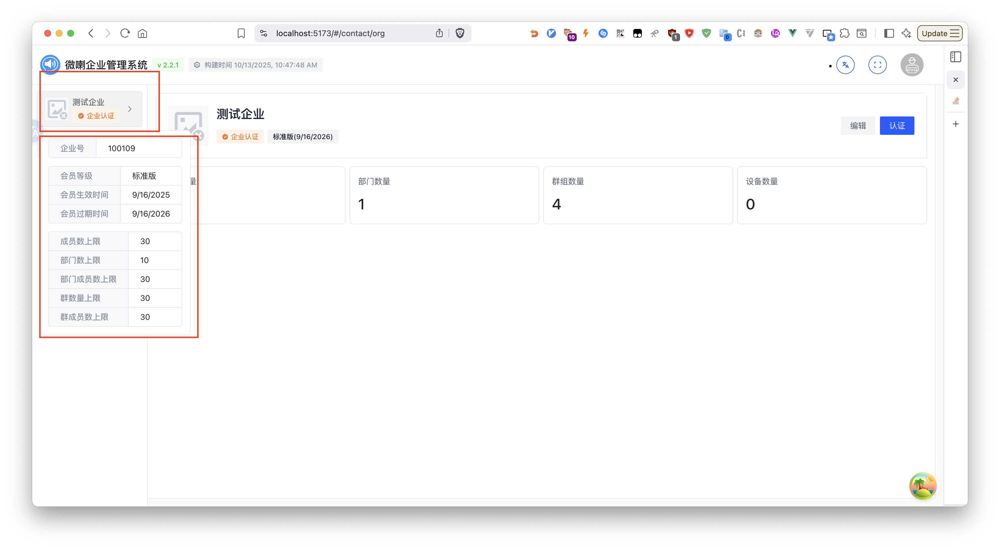
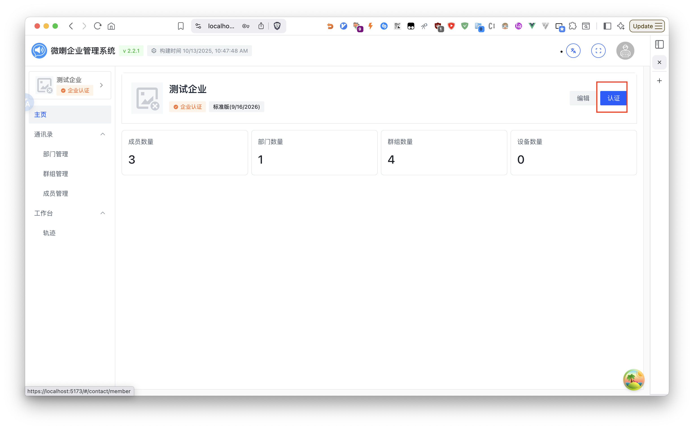
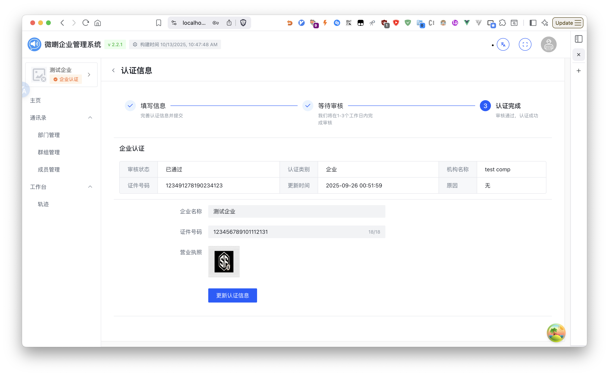

# 企业信息

## 2.1 企业基本信息

企业基本信息包括：

- **企业名称**：显示企业全称
- **企业头像**：企业标识图片
- **认证状态**：显示企业认证状态
- **VIP信息**：显示会员等级和有效期
- **统计信息**：
  - 成员数量
  - 部门数量
  - 群组数量
  - 设备数量

## 2.2 企业认证

**认证流程：**

### 第一步：填写认证信息

**企业认证需要提供：**

- 企业名称
- 统一社会信用代码（18位）
- 营业执照照片

### 第二步：提交审核

- 提交认证信息后等待平台审核
- 审核状态分为：待审核、审核通过、审核失败
- 审核失败时会显示具体原因

**认证状态说明：**

- **待审核**：信息已提交，等待平台审核
- **审核通过**：认证成功，企业信息已验证
- **审核失败**：认证未通过，需根据提示修改信息重新提交
