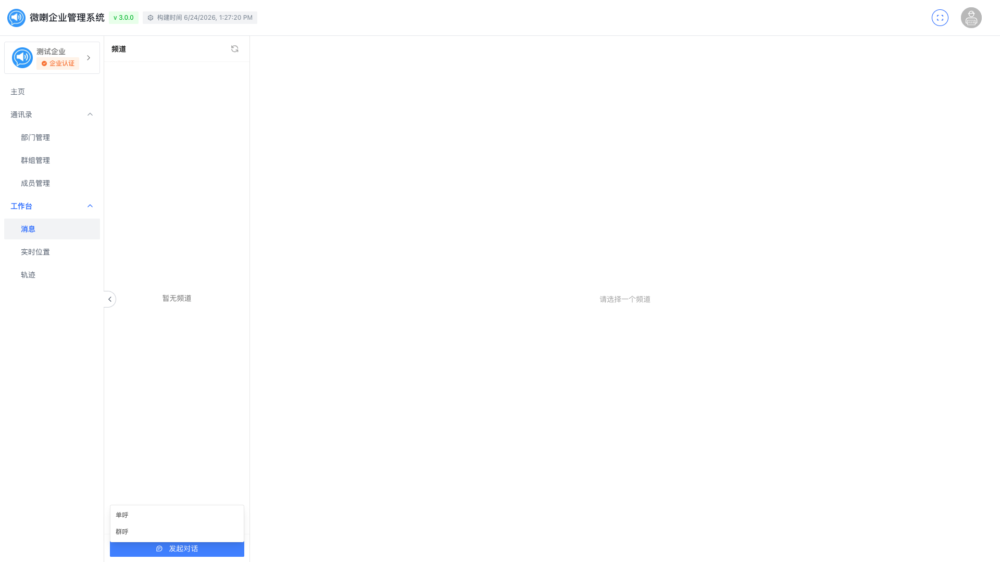
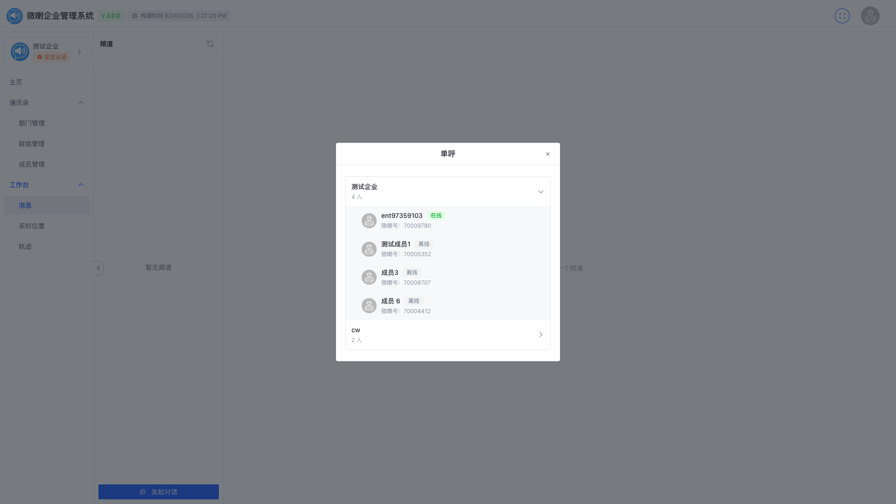
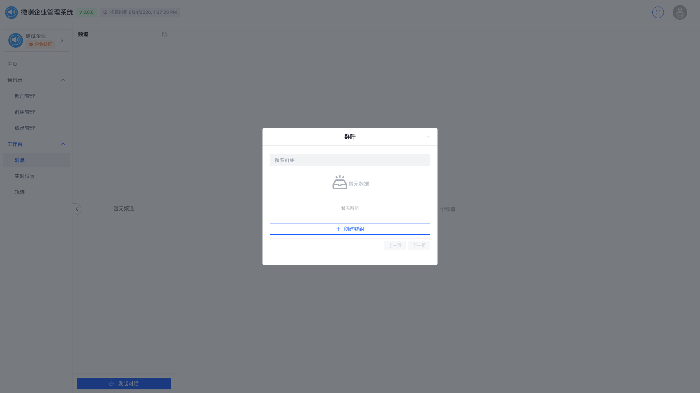

# 聊天频道

工作台聊天频道支持在企业内部发起单呼、群呼，进行语音/视频通话和消息沟通。

## 发起对话

1. 在工作台页面点击"发起对话"按钮
2. 选择对话类型：
   - **单呼**：与单个成员建立一对一通话
   - **群呼**：与多个成员或群组建立群组通话

## 单呼

选择"单呼"后，将弹出组织树选择器，可在部门树中选择目标成员发起通话。

## 群呼

选择"群呼"后，可搜索已有群组或创建新群组，然后发起群组通话。

