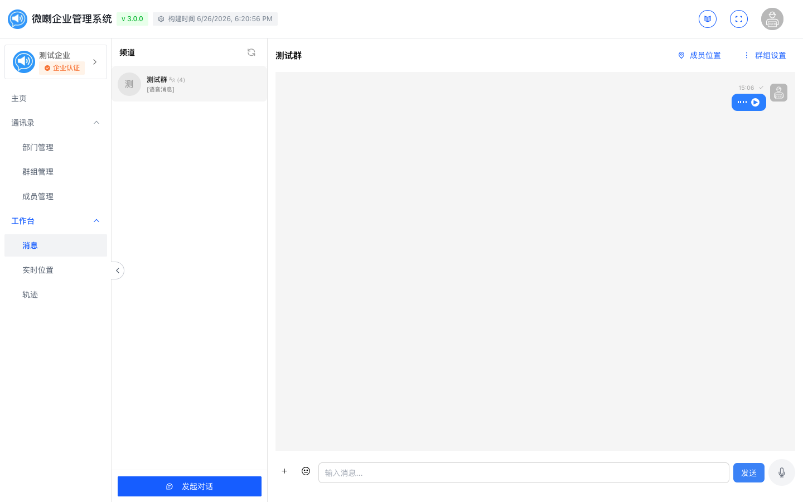
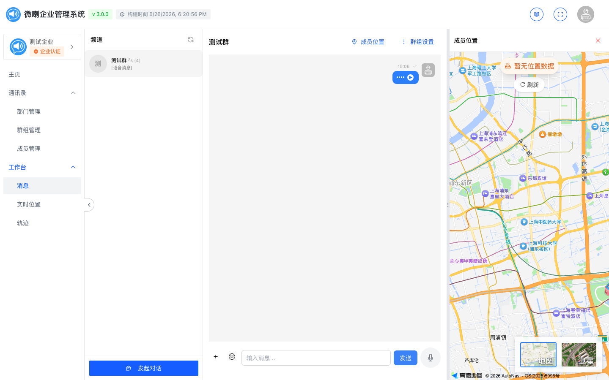
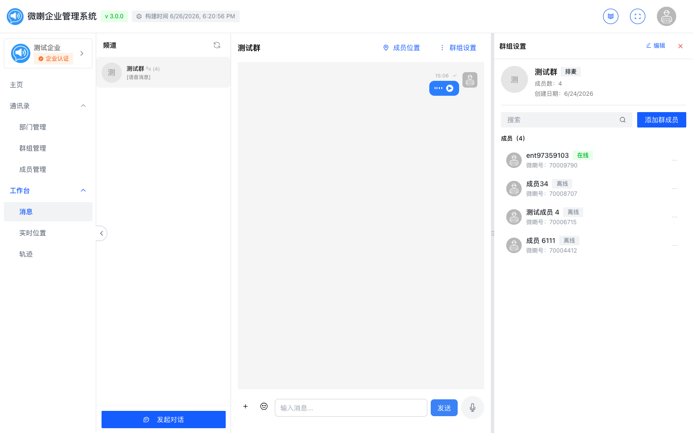

# 聊天频道

工作台聊天频道支持在企业内部发起个人对话（单呼）、群组对话（群呼），进行语音/视频通话和消息沟通。

## 发起对话

1. 在工作台页面点击"发起对话"按钮
2. 选择对话类型：
   - **个人对话（单呼）**：与单个成员建立一对一通话
   - **群组对话（群呼）**：与多个成员或群组建立群组通话

## 个人对话（单呼）

选择"个人对话（单呼）"后，将弹出组织树选择器，可在部门树中选择目标成员发起通话。

## 群组对话（群呼）

选择"群组对话（群呼）"后，可搜索已有群组或创建新群组，然后发起群组通话。

## 右侧边栏

打开某个聊天会话后，会话头部会显示右侧边栏按钮：

- **成员位置**：查看当前会话中成员的实时位置。
- **群组设置**：仅在群聊中显示，用于查看群组信息和管理群成员。

点击对应按钮，右侧会滑出相应的面板；再次点击同一按钮即可关闭面板。

### 成员位置

点击"成员位置"按钮，右侧展开成员位置面板，可查看会话成员的实时位置信息。

### 群组设置

在群聊会话中点击"群组设置"按钮，右侧展开群组设置面板，可查看群信息并管理群成员。

