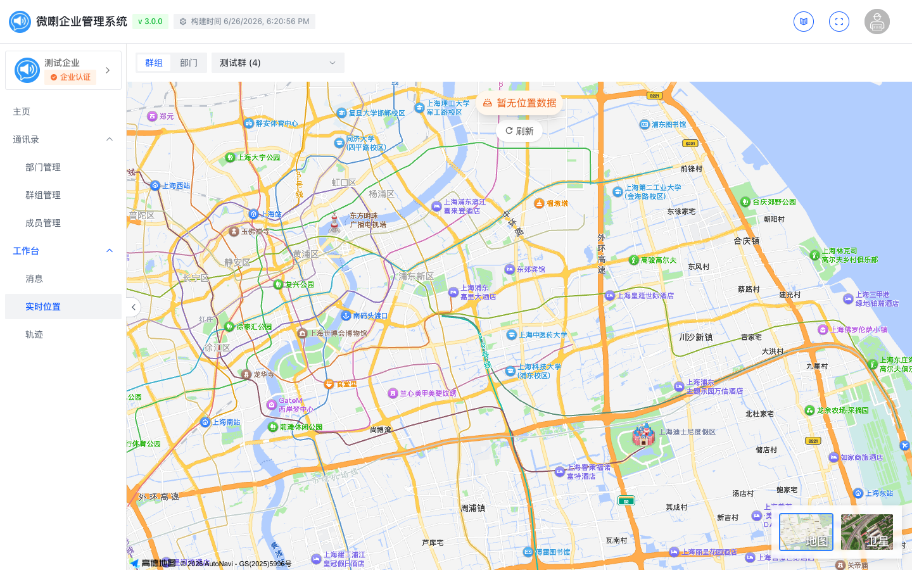

# 实时位置

实时位置功能可在地图上查看企业成员或群组的当前位置，支持按群组或部门筛选。

## 操作步骤

1. 进入工作台 -> 实时位置页面
2. 选择查看维度：
   - **群组**：查看某个群组内所有成员的位置
   - **部门**：查看某个部门内所有成员的位置
3. 在下拉选择器中选择目标群组或部门
4. 地图将自动加载并显示对应成员的位置标记

## 功能特点

- 支持群组/部门两种维度筛选
- 地图模式与卫星模式一键切换
- 成员位置实时更新
