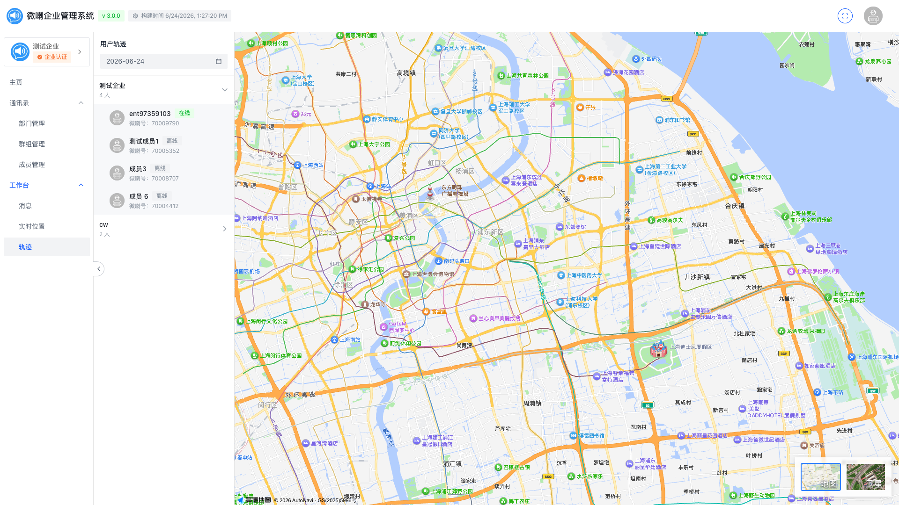
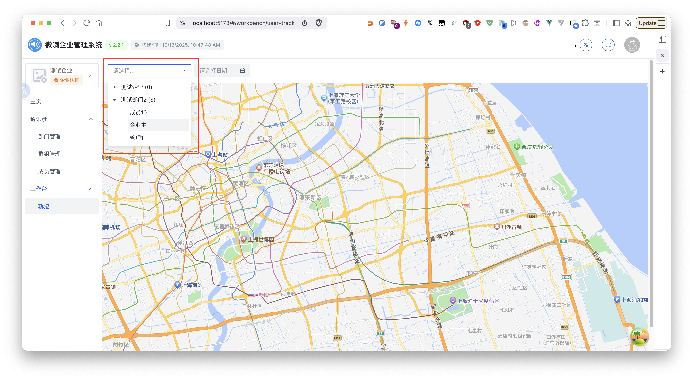
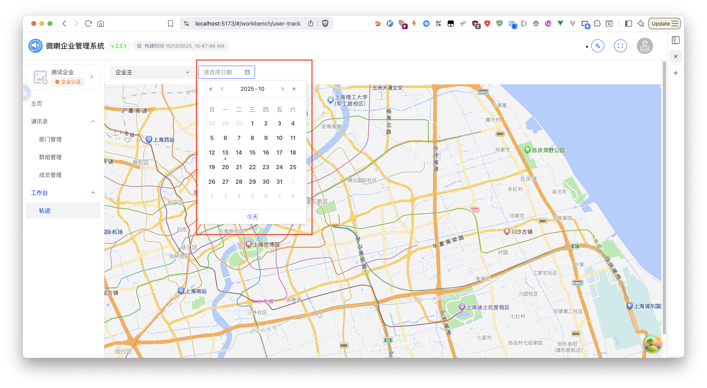
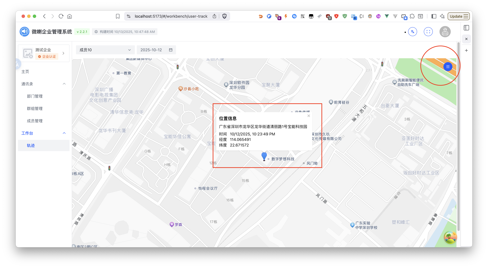
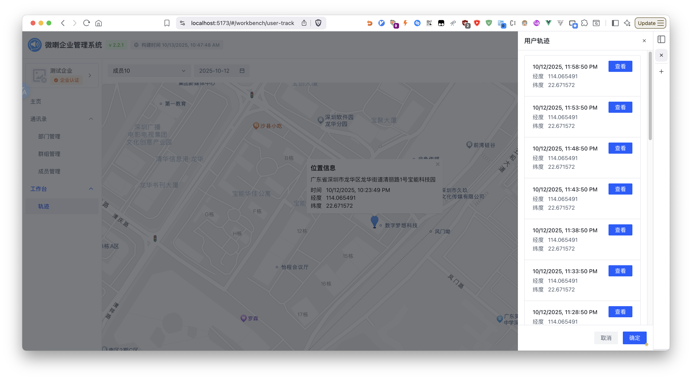

# 成员轨迹

## 操作步骤

### 第一步：选择成员
1. 进入工作台 -> 用户轨迹页面
2. 在左侧部门树中选择目标成员
   - 展开部门树查看所有部门
   - 点击部门加载该部门下的成员列表
   - 选择具体成员

### 第二步：选择日期
1. 使用日期选择器选择要查看的日期
2. 系统会自动加载该日期下的轨迹数据

### 第三步：查看轨迹
1. **地图视图**：
   - 在地图上显示成员的移动轨迹线
   - 轨迹点以标记形式显示
   - 点击标记可查看该位置的详细信息

2. **轨迹列表**：
   - 点击地图右上角菜单按钮打开轨迹列表
   - 显示所有轨迹点的时间、经纬度信息
   - 可点击"查看"按钮定位到具体位置

3. **位置详情**：
   - 点击地图上的标记点
   - 显示详细的位置信息：
     - 省市区街道详细地址
     - 具体时间
     - 经纬度坐标

## 功能特点

- 支持按日期查询历史轨迹
- 地图可视化显示移动路径
- 详细的位置反地理编码信息
- 轨迹点时间轴展示
- 快速定位到特定位置

 

