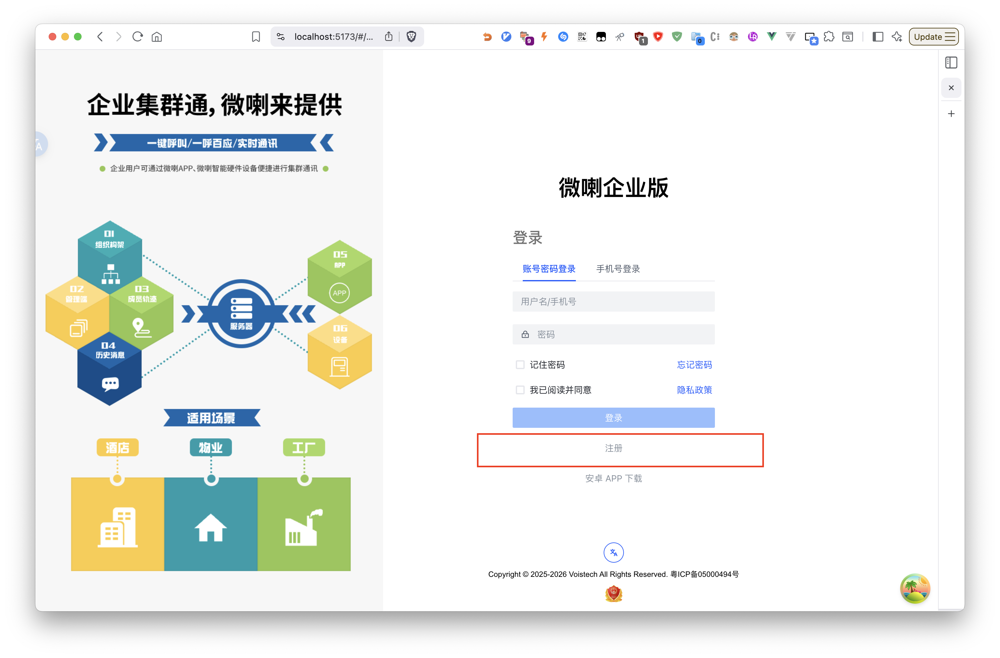
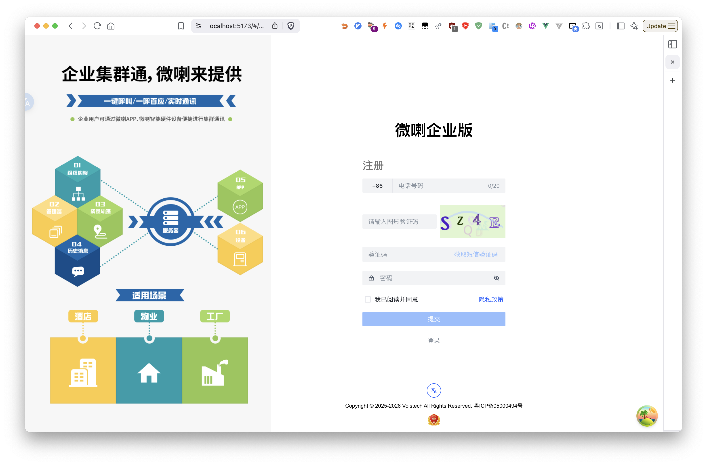
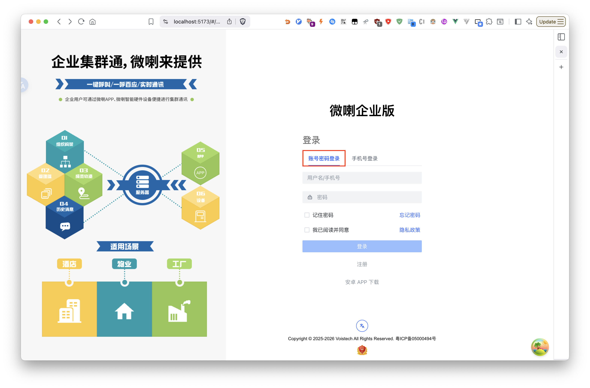
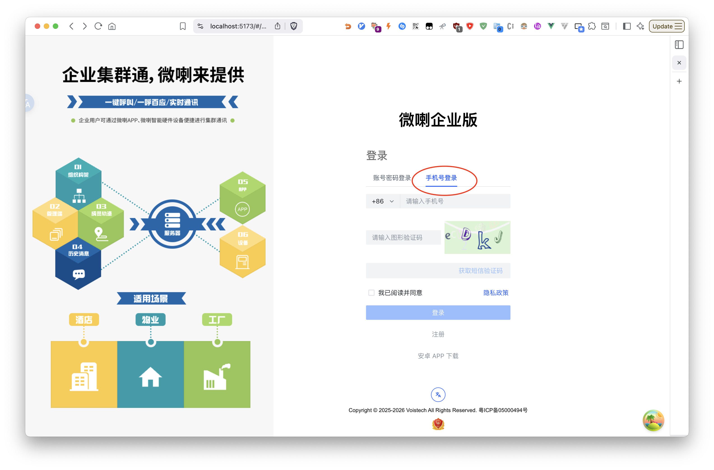
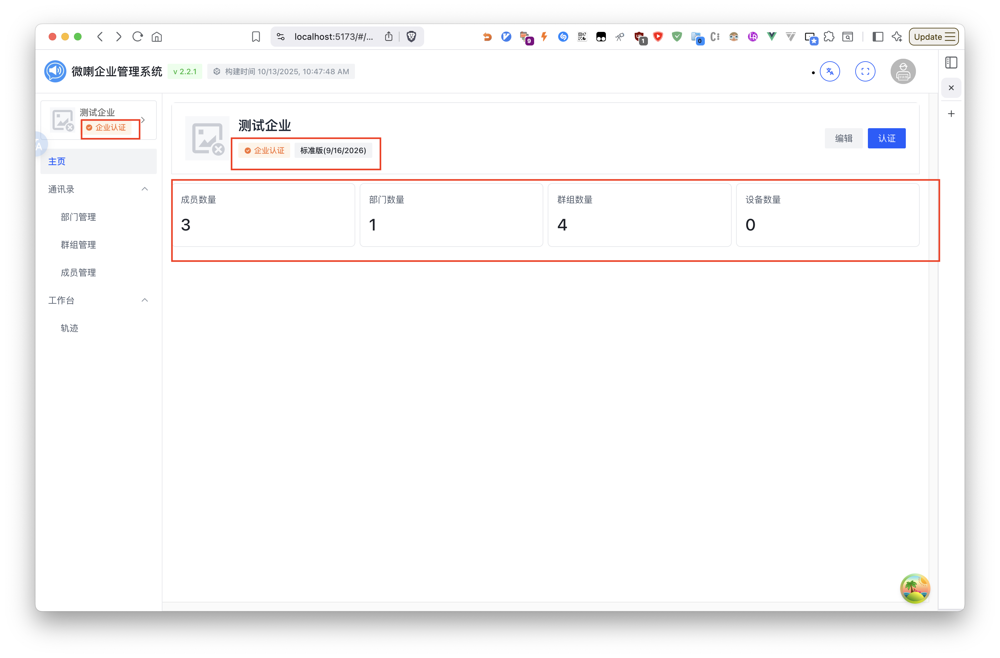
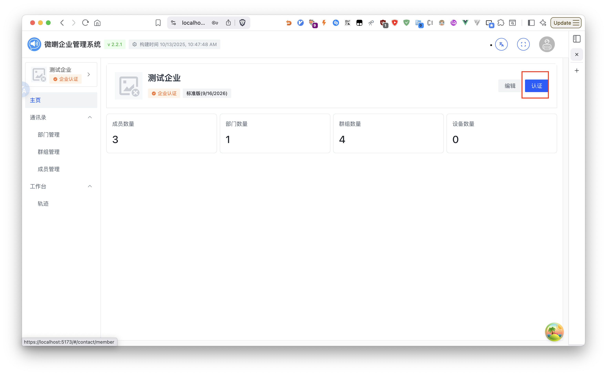
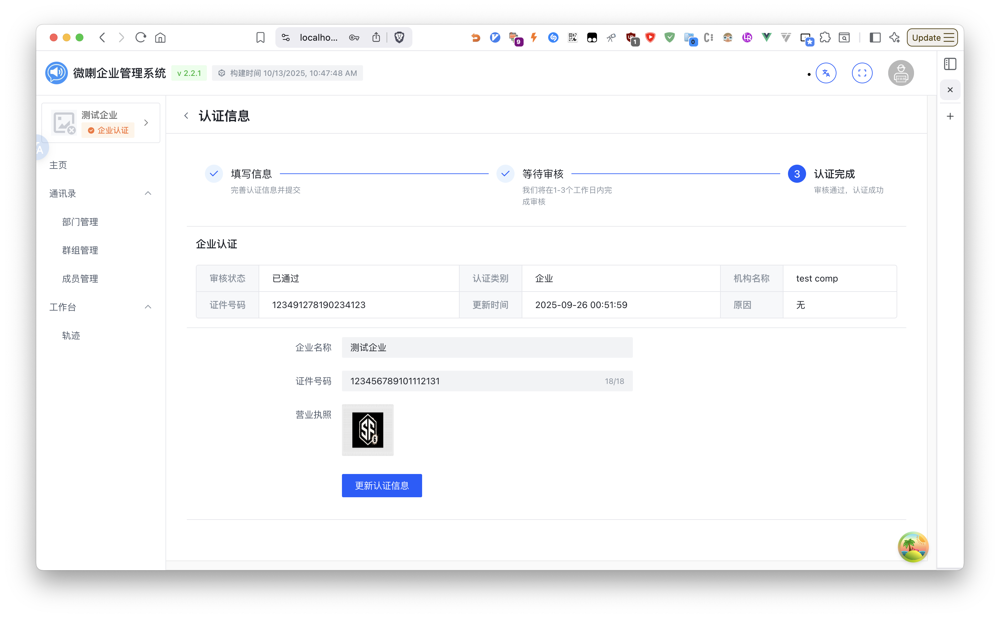

# 微啦工作平台用户手册

## 1. 账户管理

### 1.1. 注册账号

**步骤说明：**

1. **访问注册页面**
   - 在登录页面点击"注册"按钮进入注册页面

2. **填写注册信息**
   - 输入手机号码（11位）
   - 输入图形验证码
   - 获取并输入短信验证码
   - 设置登录密码
   - 阅读并同意隐私协议

3. **完成注册**
   - 点击"注册"按钮提交信息
   - 注册成功后自动跳转到登录页面

**注意事项：**

- 手机号必须是有效的11位数字
- 密码需要符合安全要求
- 必须同意隐私协议才能注册

### 1.2. 账号/手机号登录

**登录方式：**

#### 方式一：密码登录
1. 输入账号/手机号
2. 输入密码
3. 可选择"记住密码"功能
4. 点击"登录"按钮

#### 方式二：短信验证码登录
1. 切换到"手机号登录"标签页
2. 选择国家代码（默认+86）
3. 输入手机号码
4. 输入图形验证码
5. 获取短信验证码
6. 输入收到的短信验证码
7. 点击"登录"按钮

**功能特点**

- 支持账号密码和手机验证码两种登录方式
- 记住密码功能方便下次快速登录
- 忘记密码时可点击"忘记密码"链接重置

## 2. 企业信息

### 2.1 企业基本信息

企业基本信息包括：
- **企业名称**：显示企业全称
- **企业头像**：企业标识图片
- **认证状态**：显示企业认证状态
- **VIP信息**：显示会员等级和有效期
- **统计信息**：
  - 成员数量
  - 部门数量
  - 群组数量
  - 设备数量

### 2.2 企业认证

**认证流程：**

#### 第一步：选择认证类型

- **企业认证**：适用于公司、组织等法人实体
- **个人认证**：适用于个体工商户或个人

#### 第二步：填写认证信息

**企业认证需要提供：**

- 企业名称
- 统一社会信用代码（18位）
- 营业执照照片

**个人认证需要提供：**

- 个人姓名
- 身份证号码（18位）
- 身份证正面照片
- 身份证反面照片

#### 第三步：提交审核

- 提交认证信息后等待平台审核
- 审核状态分为：待审核、审核通过、审核失败
- 审核失败时会显示具体原因

**认证状态说明：**

- **待审核**：信息已提交，等待平台审核
- **审核通过**：认证成功，企业信息已验证
- **审核失败**：认证未通过，需根据提示修改信息重新提交

## 3. 通讯录

### 3.1 成员管理

#### 创建新成员

**操作步骤：**
1. 在成员管理页面点击"创建成员"按钮
2. 填写成员信息：
   - **姓名**（必填）：成员真实姓名
   - **部门**（可选）：选择所属部门
   - **工号**（可选）：员工工号
   - **手机号**（可选）：联系方式
   - **密码**（必填）：初始登录密码
   - **性别**（可选）：选择性别
   - **头像**（可选）：上传成员头像
   - **位置共享**（可选）：是否开启位置共享
   - **部门管理员**（可选）：是否设置为部门管理员
   - **轨迹权限**（可选）：设置轨迹查看权限级别

3. 点击"提交"完成创建

#### 新增设备

**操作步骤：**
1. 点击"新增设备"按钮
2. 填写设备信息
3. 完成设备添加

### 3.2 部门管理

#### 在部门内添加已有成员

**操作步骤：**
1. 进入部门详情页面
2. 点击"添加成员"按钮
3. 在部门树中选择要添加的成员
4. 勾选需要添加的成员
5. 点击"提交"完成添加

**功能特点：**
- 支持批量添加成员到部门
- 可视化部门树结构
- 可查看部门内现有成员列表

### 3.3 成员操作

对成员可以进行以下操作：

#### 编辑成员信息
- 修改成员基本信息
- 更新部门、职位等信息
- 重新设置头像

#### 重置密码
- 为成员重置登录密码
- 系统会生成新密码

#### 注销成员
- 将成员从系统中移除
- 操作前会有二次确认提示

## 4. 工作台

### 4.1 查看成员轨迹

**操作步骤：**

#### 第一步：选择成员
1. 进入工作台 -> 用户轨迹页面
2. 在左侧部门树中选择目标成员
   - 展开部门树查看所有部门
   - 点击部门加载该部门下的成员列表
   - 选择具体成员

#### 第二步：选择日期
1. 使用日期选择器选择要查看的日期
2. 系统会自动加载该日期下的轨迹数据

#### 第三步：查看轨迹
1. **地图视图**：
   - 在地图上显示成员的移动轨迹线
   - 轨迹点以标记形式显示
   - 点击标记可查看该位置的详细信息

2. **轨迹列表**：
   - 点击地图右上角菜单按钮打开轨迹列表
   - 显示所有轨迹点的时间、经纬度信息
   - 可点击"查看"按钮定位到具体位置

3. **位置详情**：
   - 点击地图上的标记点
   - 显示详细的位置信息：
     - 省市区街道详细地址
     - 具体时间
     - 经纬度坐标

**功能特点：**
- 支持按日期查询历史轨迹
- 地图可视化显示移动路径
- 详细的位置反地理编码信息
- 轨迹点时间轴展示
- 快速定位到特定位置

 

## 其他

### 权限分级管理

- 支持企业主、部门管理员、普通成员三级权限

### 表单搜索

- 支持按姓名、工号、微啦号、手机号搜索

### 表单过滤

---

**注意：** 本手册内容基于当前系统功能编写，具体操作界面可能会随系统更新而变化。如有疑问，请联系系统管理员。

*最后更新日期：2025年10月13日*
